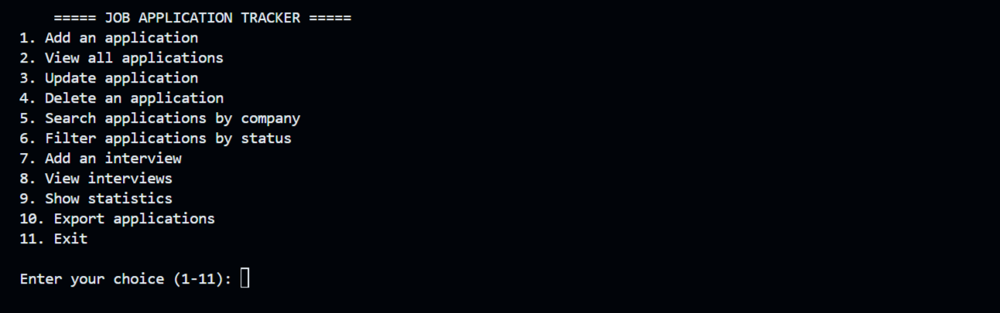
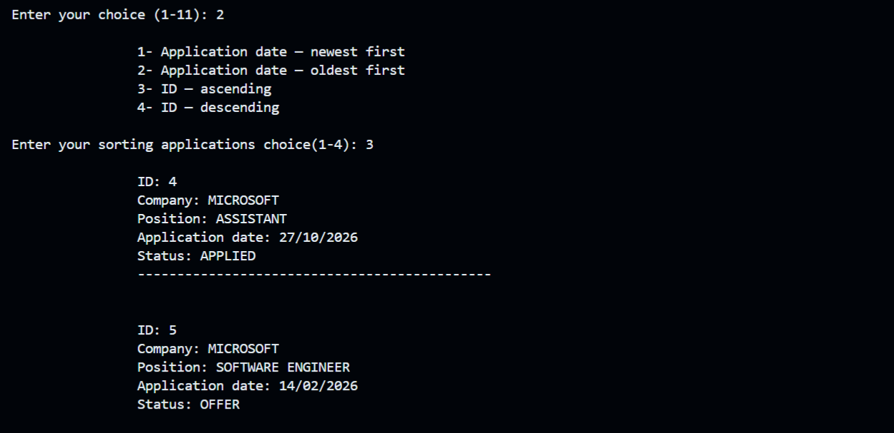
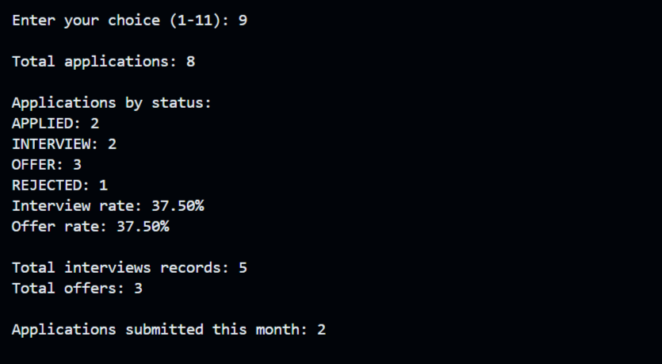
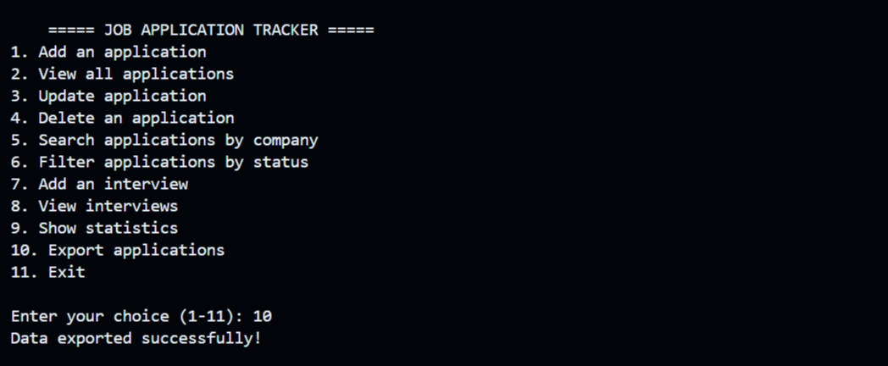

# Job Application Tracker

A lightweight Python Command-Line Interface (CLI) application designed to help job seekers organize and track their applications. 


## Project Purpose

This project was developed as a hands-on learning experience to practise and strengthen Python programming skills by building a practical application. It provided an opportunity to apply concepts such as CRUD operations, SQLite database management, error handling, logging, and CSV file handling in a real-world-style project.


## Features

- Create: Add new job applications with company name, position, application date, and status.
- Read: View all applications and sort them by date or ID.
- Update: Modify application details, including company, position, date, and status.
- Delete: Remove applications with confirmation.
- Search: Find applications by company name.
- Filter: Filter applications by status.
- Interview Management: Add and view interviews linked to job applications, including interview dates, types, and notes.
- Statistics and Reports: Display application statistics, interview rates, offer rates, and monthly application summaries.
- CSV Export: Export application records into a CSV file.
- Database Storage: Use Python's built-in sqlite3 module for persistent local data storage.
- Error Handling and Logging: Handle database and file errors and record important events in a log file.


## Screenshots

### Main Menu


### Applications List


### Statistics


### CSV Export



## Technologies Used

- Python: Main programming language.
- SQLite: Relational database for storing application and interview records.
- sqlite3: Python module for database operations.
- csv: Python module for exporting application data.
- logging: Python module for recording application events and errors.
- datetime: Python module for handling and formatting dates.
- os: Python module for managing directories and file operations.


## Dependencies

This project uses only Python's built-in modules. No external packages are required.


## Installation and Usage

- Clone the repository:

```bash
git clone https://github.com/battahahmed/job-application-tracker
```

- Navigate to the project directory:

```bash
cd job-application-tracker
```

- Run the application:

```bash
python main.py
```

The application uses SQLite to create and manage its local database.


## Project Structure

```text
job-application-tracker/
│
├── main.py          # Main application and user interface
├── database.py      # Database operations and application logic
├── README.md        # Project documentation
├── LICENSE          # MIT License
└── .gitignore       # Files excluded from Git
```


## License

This project is licensed under the MIT License. See the [LICENSE](LICENSE) file for details.
